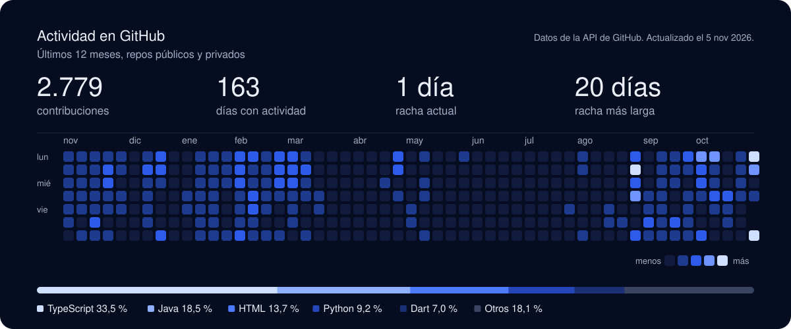

<a href="https://quobit.es">
  <picture>
    <source media="(prefers-color-scheme: dark)" srcset="./profile/hero-dark.svg">
    <source media="(prefers-color-scheme: light)" srcset="./profile/hero-light.svg">
    
  </picture>
</a>

  
  
  

Hola, soy **Mauro**. Desarrollo software de principio a fin (backend, frontend, móvil y despliegue) y, junto a mi socio, llevo **[Quobit](https://quobit.es)**, un estudio de software en Sevilla. Hacemos webs, apps y automatizaciones a medida para empresas y particulares, sin intermediarios: hablas directamente con quien escribe el código.

## Lo que tengo en producción

**[TrainPicker](https://trainpicker.quobit.es)**, bot de Telegram. Vigila trenes completos de Renfe y Ouigo y te avisa en cuanto se libera una plaza, con un botón que abre la compra ya rellenada. [Pruébalo en Telegram](https://t.me/TrainPickerBot?start=github).
Python · API de Telegram · Docker

**[Cardeo](https://cardeo.quobit.es)**, cartas online para jugar con la peña que tienes delante. Cada uno juega desde su móvil, con salas en tiempo real y cinco modos de juego.
React · TypeScript · Socket.IO · Node.js

**[PlanABC](https://planabc.quobit.es)**, app para parejas (PWA). 27 planes, uno por cada letra del abecedario, en el orden que os apetezca.
Next.js · Spring Boot · PostgreSQL

**[reel-gallery](https://github.com/mauroz9/reel-gallery)**, paquete npm de código abierto. Galería mosaico que se anima con el scroll, para fotos, vídeos y Live Photos, con visor 3D opcional. [Ver la demo](https://mauroz9.github.io/reel-gallery/).
TypeScript · three.js · React, Vue, Svelte, Angular y Web Component

## En qué te puedo ayudar

- **Webs y apps a medida**: de la web de tu negocio a una app con usuarios, pagos, reservas y un panel para gestionarlo tú.
- **Automatizaciones**: ese proceso que alguien repite cada día con hojas de cálculo y correos, conectado y funcionando solo.
- **IA aplicada**: asistentes, resúmenes y lectura de PDFs y formularios, conectados a las herramientas que ya usas.
- **Mantenimiento**: seguimos después del lanzamiento, con arreglos, mejoras y alguien que coge el teléfono.

## Stack

   
   
  

## Actividad

<picture>
  <source media="(prefers-color-scheme: dark)" srcset="./profile/activity-dark.svg">
  <source media="(prefers-color-scheme: light)" srcset="./profile/activity-light.svg">
  
</picture>

La genera cada noche <a href=".github/workflows/actividad.yml">este workflow</a> con la API de GitHub.

---

**¿Tienes algo en mente?** Escríbeme a [info@quobit.es](mailto:info@quobit.es) y te contesto en uno o dos días. Muchos proyectos empiezan con un «no sé si esto lo hacéis».
