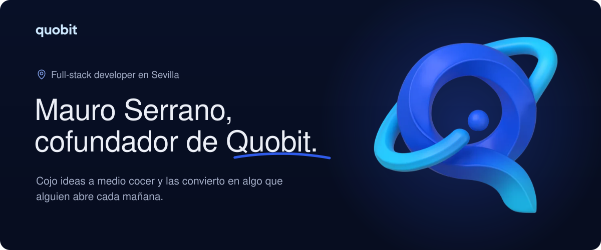
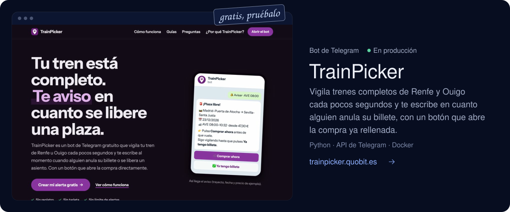
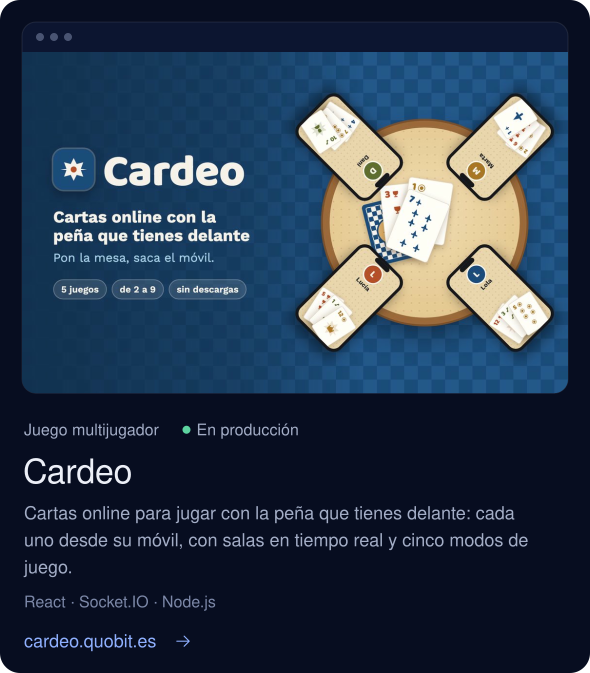
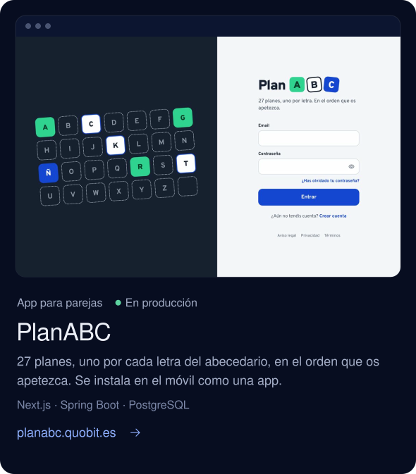
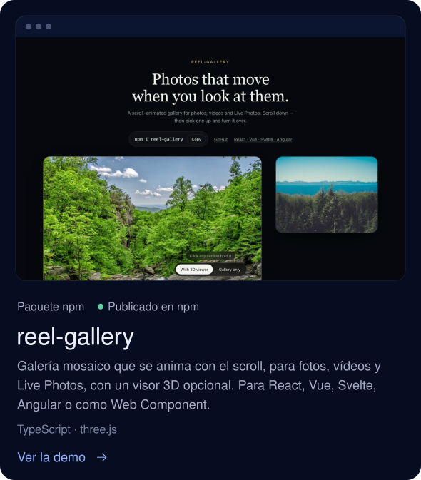
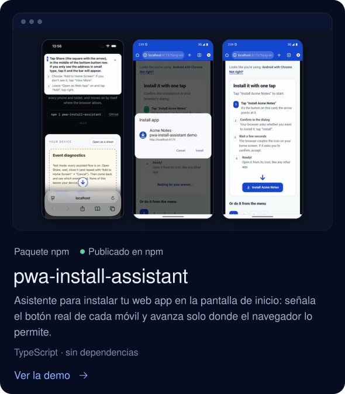
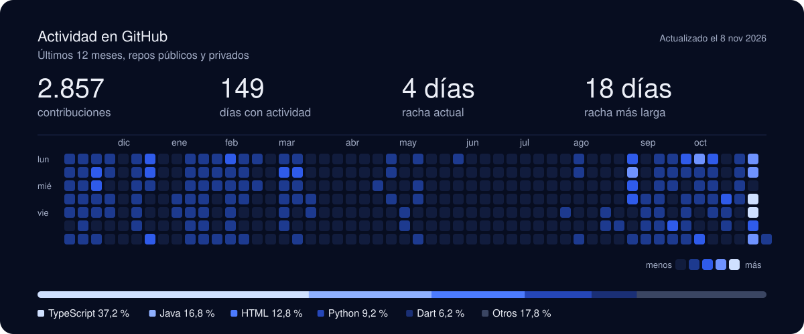

  
  
  
  

Hola, soy **Mauro**. Desarrollo software de principio a fin (backend, frontend, móvil y despliegue) y, junto a mi socio, llevo **[Quobit](https://quobit.es)**, un estudio de software en Sevilla. Hacemos webs, apps y automatizaciones a medida para empresas y particulares, sin intermediarios: hablas directamente con quien escribe el código.

## Lo que ya funciona

  
  

  
  

## En qué te puedo ayudar

- **Webs y apps a medida**: de la web de tu negocio a una app con usuarios, pagos, reservas y un panel para gestionarlo tú.
- **Automatizaciones**: ese proceso que alguien repite cada día con hojas de cálculo y correos, conectado y funcionando solo.
- **IA aplicada**: asistentes, resúmenes y lectura de PDFs y formularios, conectados a las herramientas que ya usas.
- **Mantenimiento**: seguimos después del lanzamiento, con arreglos, mejoras y alguien que coge el teléfono.

## Stack

   
   
  

## Actividad

---

**¿Tienes algo en mente?** Escríbeme a [info@quobit.es](mailto:info@quobit.es) y te contesto en uno o dos días. Muchos proyectos empiezan con un «no sé si esto lo hacéis».
