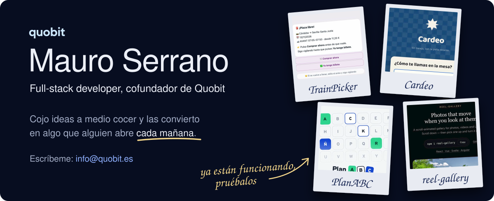
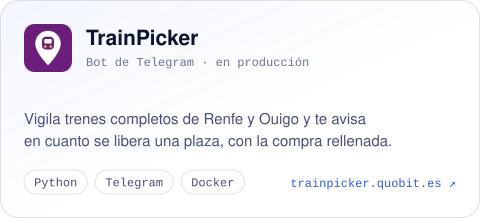
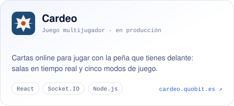
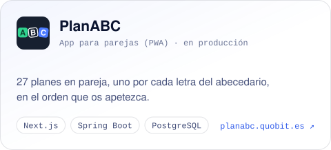
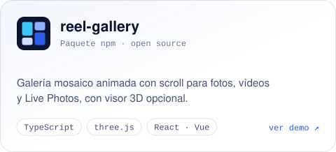

<a href="https://quobit.es">
  <picture>
    <source media="(prefers-color-scheme: dark)" srcset="./profile/hero-dark.svg">
    <source media="(prefers-color-scheme: light)" srcset="./profile/hero-light.svg">
    
  </picture>
</a>

  
  
  
  

Hola, soy **Mauro**. Desarrollo software de principio a fin —backend, frontend, móvil y despliegue— y junto a mi socio llevo **[Quobit](https://quobit.es)**, un estudio de software en Sevilla. Hacemos webs, apps y automatizaciones a medida para empresas y particulares, **sin intermediarios**: hablas directamente con quien escribe el código.

## Proyectos en producción

Productos propios, diseñados, desarrollados y desplegados de principio a fin.

<table>
  <tr>
    <td width="50%" valign="top">
      <a href="https://trainpicker.quobit.es"><picture>
        <source media="(prefers-color-scheme: dark)" srcset="./profile/card-trainpicker-dark.svg">
        
      </picture></a>
    </td>
    <td width="50%" valign="top">
      <a href="https://cardeo.quobit.es"><picture>
        <source media="(prefers-color-scheme: dark)" srcset="./profile/card-cardeo-dark.svg">
        
      </picture></a>
    </td>
  </tr>
  <tr>
    <td width="50%" valign="top">
      <a href="https://planabc.quobit.es"><picture>
        <source media="(prefers-color-scheme: dark)" srcset="./profile/card-planabc-dark.svg">
        
      </picture></a>
    </td>
    <td width="50%" valign="top">
      <a href="https://mauroz9.github.io/reel-gallery/"><picture>
        <source media="(prefers-color-scheme: dark)" srcset="./profile/card-reel-gallery-dark.svg">
        
      </picture></a>
    </td>
  </tr>
</table>

## En qué te puedo ayudar

- **Webs y apps a medida** — de la web de tu negocio a una app con usuarios, pagos, reservas y un panel para gestionarlo tú.
- **Automatizaciones** — ese proceso que alguien repite cada día con hojas de cálculo y correos, conectado y funcionando solo.
- **IA aplicada** — asistentes, resúmenes y lectura de PDFs y formularios conectados a las herramientas que ya usas.
- **Mantenimiento** — seguimos después del lanzamiento, con arreglos, mejoras y alguien que coge el teléfono.

## Stack

   
   
  

## Actividad

  
  

---

  <b>¿Tienes algo en mente?</b> Escríbeme a <a href="mailto:info@quobit.es">info@quobit.es</a> — te contesto en uno o dos días. 
  Muchos proyectos empiezan con un «no sé si esto lo hacéis».

